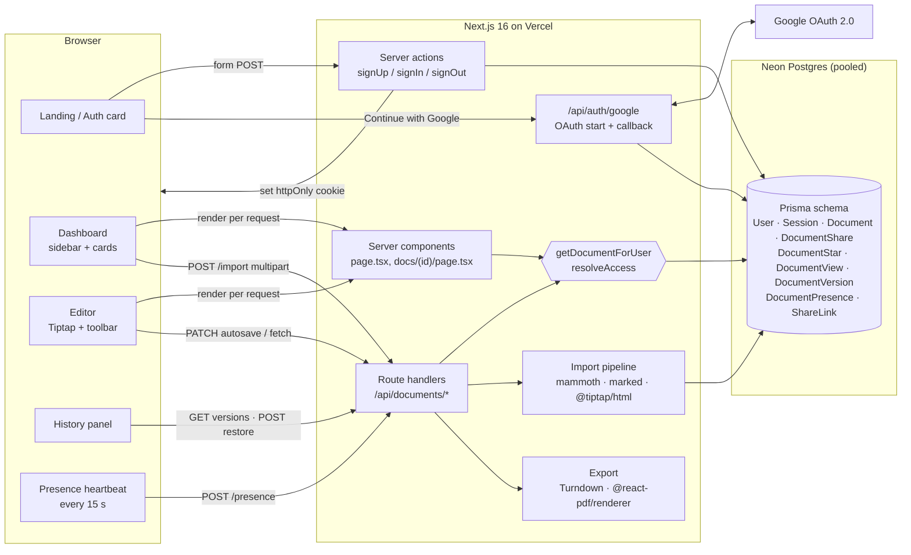
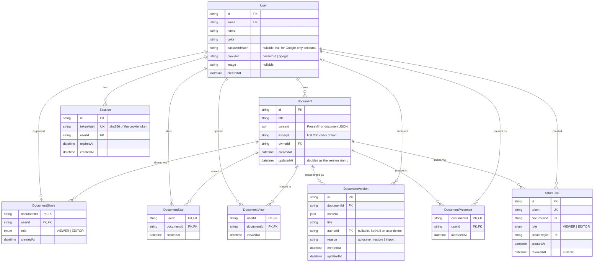
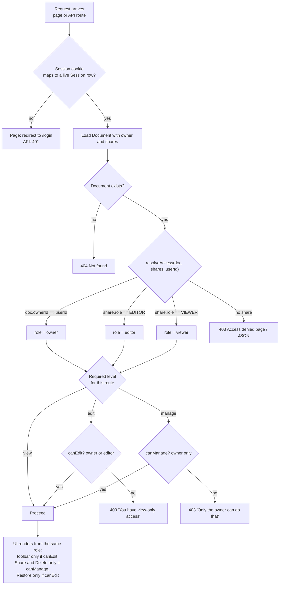
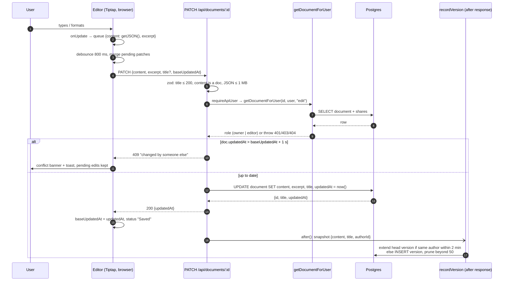

# Architecture

This note follows the shape of a system-design discussion: requirements, API, data model,
the four diagrams, two deep dives, tradeoffs, scaling posture and roadmap. Everything is
sized for a 4–6 hour build a reviewer can run, not for a billion users, and every diagram
describes what is actually implemented in this repository.

## 1. Requirements

**Functional (all shipped)**

- Create, rename, edit, delete, reopen and star documents.
- Rich text: bold, italic, underline, strikethrough, headings 1–3, bullet and numbered lists, quotes, code blocks, undo/redo.
- Import a `.txt`, `.md` or `.docx` file as a new document.
- Owner shares a document with another user as viewer or editor, by email or by link; the UI distinguishes owned from shared.
- Real accounts: email + password sign-up and sign-in, optional Google sign-in, server-side sessions.
- Everything persists across refresh with formatting intact.
- Stretch: version history with restore, Markdown and PDF export, share-by-link with a role, presence indicators.

**Non-functional (scoped for a demo)**

- Zero cost to run: Vercel free tier + Neon free tier, no third-party realtime service.
- A reviewer can exercise sharing in under two minutes: seeded accounts with a documented password.
- Failure modes are explicit: 400/401/403/404/409 with human-readable messages surfaced inline.
- The access logic is unit tested, and the sharing matrix is also exercised end to end with three signed-in browsers.

**Explicitly out of scope**

Comments and suggestion mode (deep editor-engine work), live cursors and real-time
co-editing (needs a CRDT relay), email verification and password reset, folders, search.

## 2. System architecture

How the pieces talk:

- **Server components** (`page.tsx`, `docs/[id]/page.tsx`) read the session cookie, resolve the user's role and render the dashboard or editor shell with the role baked in. Pages render per request on purpose; Cache Components was turned off because every page depends on the cookie.
- **Server actions** handle sign-up, sign-in and sign-out. They are plain form posts, so they work before any JavaScript loads.
- **Route handlers** under `/api/documents` form a small REST surface for everything the client does after load: autosave, sharing, star, import, export, versions, presence, links. Each one calls `requireApiUser` then `getDocumentForUser` before touching data.
- **Google OAuth** is implemented directly against Google's endpoints (about 60 lines) and is enabled only when client credentials are present.
- **Postgres on Neon** is reached through Neon's pooled endpoint so hundreds of short-lived serverless invocations share a bounded number of real connections.

## 3. API contract

All routes require the session cookie. Responses are JSON unless noted; errors are `{ error: string }`.

| Method | Path | Who | Purpose |
|---|---|---|---|
| POST | `/api/documents` | any user | Create empty document (owner = caller) |
| GET | `/api/documents/:id` | owner, editor, viewer | Document plus caller's role |
| PATCH | `/api/documents/:id` | owner, editor | Rename and/or save content; optional `baseUpdatedAt` for conflict detection (409) |
| DELETE | `/api/documents/:id` | owner | Delete, cascades to shares, stars, views, versions, links |
| POST | `/api/documents/:id/shares` | owner | Grant or change access `{ email, role }` |
| DELETE | `/api/documents/:id/shares/:userId` | owner | Revoke access |
| POST | `/api/documents/:id/star` | any role | Toggle the caller's star |
| POST | `/api/documents/import` | any user | Multipart `file` → new document |
| GET | `/api/documents/:id/versions` | any role | List versions, newest first |
| GET | `/api/documents/:id/versions/:vid` | any role | One version with rendered HTML for preview |
| POST | `/api/documents/:id/versions/:vid/restore` | owner, editor | Replace live content with the snapshot |
| GET | `/api/documents/:id/export?format=markdown\|pdf` | any role | File download |
| POST / DELETE | `/api/documents/:id/presence` | any role | Heartbeat / leave |
| GET / POST | `/api/documents/:id/links` | owner | List / create invite links `{ role }` |
| DELETE | `/api/documents/:id/links/:linkId` | owner | Revoke a link |
| GET | `/api/users` | any user | Directory for the share dialog |
| GET | `/share/:token` | signed-in user | Redeem a link, redirect to the document |

## 4. Database ER diagram

Design notes:

- **Ownership is a column, not a share row with role OWNER.** "Who can delete or share" is a one-line check and a document can never have zero owners.
- **Shares are a join table** keyed on `(documentId, userId)`, so a user has exactly one role per document and upserting a share changes the role.
- **`content` is ProseMirror JSON**, the editor's native format. No lossy conversions on save or load; versions and export read the same structure. `excerpt` is denormalised so the dashboard never parses JSON.
- **Sessions are rows, not JWTs.** Sign-out really invalidates, and only the sha256 of the cookie token is stored so a database leak does not leak live sessions.
- **Indexes serve the real queries:** `(ownerId, updatedAt desc)` for My documents, `(userId)` on shares and stars, `(userId, viewedAt desc)` for Recent, `(documentId, createdAt desc)` for history, `(documentId, lastSeenAt)` for presence, `(expiresAt)` for session cleanup. Every foreign key cascades so deleting a document removes everything hanging off it.

## 5. Sharing and access logic

`resolveAccess` in `src/lib/permissions.ts` is a pure function with no database or framework
imports, which is why it can be unit tested exhaustively. `getDocumentForUser` in
`src/lib/access.ts` wraps it with the database read and the three required levels. Every
route handler and the editor page call it first, so there is exactly one place where
authorization can be wrong. Share links do not bypass this: redeeming a link materialises
an ordinary `DocumentShare` row (never downgrading an existing editor) and then every other
code path behaves as if the owner had shared by email.

## 6. Document save flow

Notes on the flow:

- **Coalescing on the client** turns a burst of keystrokes into one request; a title change and a content change in the same window travel together.
- **`baseUpdatedAt`** is the optimistic concurrency token. The one-second tolerance absorbs clock skew between the client's copy of the timestamp and Postgres.
- **On failure the pending patch is merged back**, so a network blip does not lose edits; the next keystroke retries.
- **Version history runs in `after()`**, after the response is flushed, so typing never waits for the snapshot. Consecutive autosaves by the same author within two minutes update one version row instead of creating hundreds.
- **On reload** the JSON is passed straight into `useEditor({ content })`; nothing is re-parsed, so every mark and node comes back exactly.

## 7. Deep dive: import pipeline

`file → HTML → editor JSON`. Each format gets the cheapest faithful converter: plain text is
split into paragraphs on blank lines; Markdown goes through `marked`; `.docx` goes through
`mammoth` with a style map that keeps underline. `@tiptap/html` then parses that HTML with
the **same extension set the browser editor uses** (`src/lib/editor-extensions.ts`), so
anything the editor cannot represent is dropped at import time rather than breaking later.
Type and size are checked on both client and server; the server is authoritative.

## 8. Deep dive: the other stretch features

- **Export.** Markdown goes JSON → HTML → Turndown with rules for underline (`<u>`, since Markdown has none), strike (`~~`), and tight list items. PDF is rendered directly from the JSON with `@react-pdf/renderer`: headings, lists, quotes and marks map to a small set of primitives, and no headless browser is needed, which keeps the Vercel bundle light.
- **Share links.** A row carries a role and a random token. Redeeming creates or upgrades a normal share row. Revoking stops new redemptions but keeps existing access, matching the mental model people have from Google Docs.
- **Presence.** A heartbeat every 15 s into `(documentId, userId, lastSeenAt)`; anyone seen in the last 45 s is "here". The tab pauses heartbeats when hidden and sends a keepalive DELETE on unload. Deliberately not a WebSocket: no third-party account, scales with the database, and the lag is fine for an "also here" strip.

## 9. Engineering tradeoffs

| Decision | Why | Limitation | Possible improvement |
|---|---|---|---|
| **Next.js App Router for UI and API** | One deploy, one set of env vars, no CORS; server components bake the user's role into the first render | Coupled frontend and backend; API consumers other than this UI would want a separate service | Extract `/api` into a standalone service if a mobile client appears |
| **Postgres (Neon) over SQLite or a document store** | Users / documents / shares are relational; Vercel's filesystem is ephemeral; Neon pools connections for serverless | One more account to understand (not to create) for reviewers | Read replicas for dashboard queries at scale |
| **Tiptap / ProseMirror, JSON stored as-is** | Mature schema and commands; JSON makes versioning, export and import deterministic | JSON is less inspectable than HTML in the database | Add a generated HTML column if full-text search is needed |
| **Ownership column + share join table with role enum** | Simplest model that answers "who can view / edit / manage" in one function | No groups, no inheritance, no commenter role | Add a `COMMENTER` enum value when comments exist; add teams later |
| **Hand-rolled sessions and OAuth over an auth framework** | About 200 lines I can explain line by line; no beta-version risk on Next 16; Google optional | No email verification, password reset or MFA; limiter is per instance | Resend for emails; Upstash Redis for a shared limiter |
| **Debounced autosave + 409 detection over explicit Save** | Matches Google Docs expectations; detection prevents silent overwrites | Two people editing at once see a reload banner rather than a merge | Yjs with a WebSocket relay for true co-editing |
| **Heartbeat presence over WebSockets** | Zero extra services; runs on serverless; scales with Postgres | 15 s lag; no live cursors | Liveblocks or y-websocket when live cursors are needed |
| **PDF from JSON over headless Chrome** | Light bundle, deterministic output, works anywhere Node runs | Layout is faithful to structure, not pixel-identical to the editor | Custom fonts and page headers in the PDF template |
| **shadcn/ui on Base UI** | Accessible dialogs, menus, sidebar and tabs without writing focus management; styling stays in Tailwind | One more dependency surface | Pin and audit on each upgrade |
| **`prisma db push` over migrations** | Fastest path for a demo; schema is the single source of truth | No migration history; unsafe for production data | Switch to `prisma migrate` with a direct (non-pooled) URL before real users |

## 10. Scaling posture

The app is stateless per request and deploys as serverless functions, so compute scales
horizontally by default. The work went into keeping each request cheap and the database
out of the critical path:

| Concern | In place | What a six-figure concurrent deployment adds |
|---|---|---|
| Connections | Neon pooled endpoint; one Prisma client per instance | Neon autoscaling compute, read replicas |
| Hot queries | Composite and covering indexes for every dashboard list | Materialised counts for the sidebar badges |
| Payload size | Lists capped at 60; cards carry a 200-char excerpt, never full content; counts in one transaction | Cursor pagination |
| Writes | Autosave coalesced to one PATCH per 800 ms; conflict check is a timestamp compare | Yjs/CRDT relay for concurrent editing |
| Sessions | One indexed lookup per request; expired rows self-delete | Redis session cache |
| Abuse | Per-email sign-in limiter; identical error for unknown email and wrong password | Shared Redis limiter, CAPTCHA after N failures |
| Side effects | Version snapshots and Recent bookkeeping run in `after()` | A queue for anything heavier |
| Assets | Fonts and logo self-hosted through Next's pipeline with immutable caching | Already on Vercel's CDN |

Honest ceiling: a single Neon compute handles the dashboard and editor load of tens of
thousands of active users; the first thing to break at six figures is write contention
from autosave, which is why the CRDT relay is first on the roadmap.

## 11. Next 2–4 hours

1. **Live cursors and co-editing** (half a day): Yjs bound to Tiptap with a small relay. Presence already provides the avatar strip.
2. **Comments** (3 h): a comment mark in the editor schema, a `Comment` table, a side panel with threads and resolve, plus a `COMMENTER` role.
3. **Password reset and email verification** (1 h): signed, expiring tokens via Resend's free tier.
4. **Diff view in history** (1 h): word-level diff between two versions in the preview pane.
5. **Migrations** (30 min): replace `db push` with `prisma migrate` and a direct URL.
